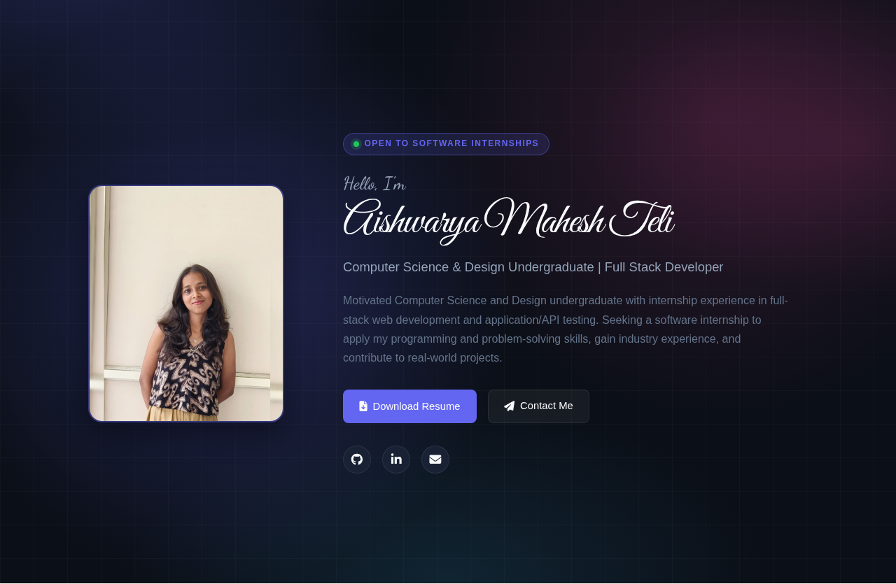
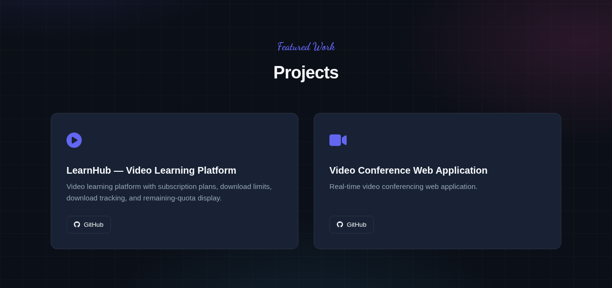
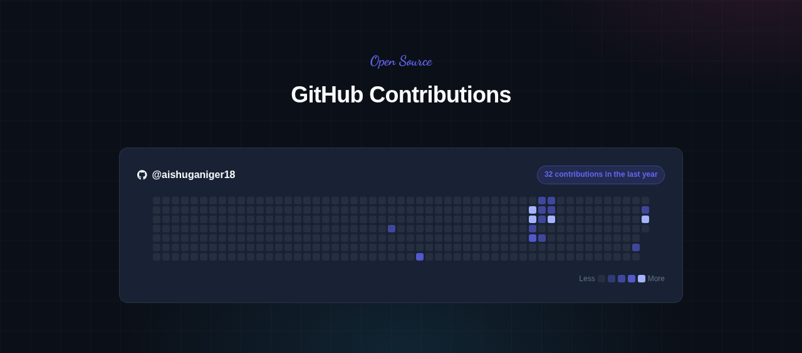
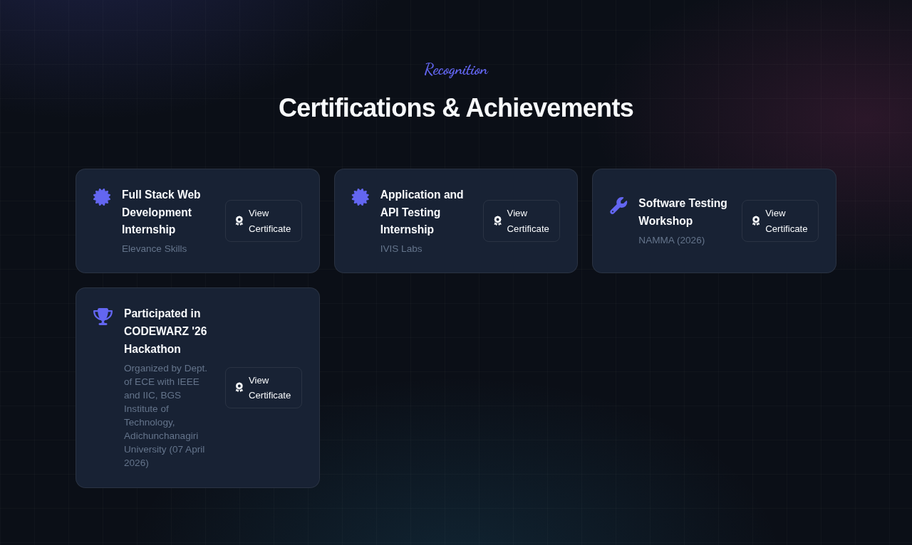
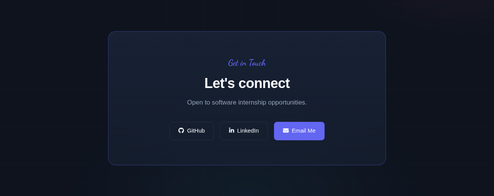

# Aishwarya Mahesh Teli — Portfolio

A personal portfolio website for **Aishwarya Mahesh Teli**, Computer Science & Design undergraduate and full-stack developer. It presents her profile, education, internship experience, projects, skills, certifications, GitHub contributions and contact details in a fast, responsive single-page experience.

## ✨ Highlights

- **Hero section** — portrait, editable intro copy, "open to software internships" badge and quick contact actions.
- **Sticky navigation** — the menu bar stays locked to the top while you scroll through every section.
- **Education timeline** — academic journey presented as a vertical timeline.
- **Internships & projects** — card grids with role, stack, description and links.
- **GitHub contributions** — a live contribution graph for the past year, fetched automatically from GitHub's public data.
- **Certifications** — with direct "View Certificate" links to the original documents.
- **Responsive design** — layouts adapt from desktop down to mobile, including a mobile navigation drawer.
- **Accessible & fast** — semantic markup, lazy animations via `IntersectionObserver`, and an edge-served static build.

## 📸 Screenshots

| Hero | Projects |
| --- | --- |
|  |  |

| GitHub contributions | Certifications |
| --- | --- |
|  |  |

| Contact |
| --- |
|  |

## 🛠 Tech Stack

- [TanStack Start](https://tanstack.com/start) (React 19) — full-stack React framework with server rendering
- [TypeScript](https://www.typescriptlang.org/)
- [Tailwind CSS v4](https://tailwindcss.com/) — design tokens and base styling
- Custom CSS design system for the portfolio page (`src/styles/portfolio.css`)
- [Font Awesome](https://fontawesome.com/) — icons
- [Vite](https://vite.dev/) — build tooling

## 🚀 Getting Started

### Prerequisites

- [Node.js](https://nodejs.org/) 20+
- [Bun](https://bun.sh/) (optional, used by the maintainer)

### Install & run locally

```bash
npm install
npm run dev
```

The site is served at `http://localhost:8080`.

### Build for production

```bash
npm run build
npm run start
```

## 📁 Project Structure

```
src/
├── routes/
│   ├── __root.tsx      # Document shell, fonts, global head metadata
│   └── index.tsx       # The portfolio page (all sections + GitHub graph)
├── styles/
│   ├── styles.css      # Global design tokens (Tailwind v4 theme)
│   └── portfolio.css   # Portfolio page design system
├── assets/             # Portrait & certificate documents (CDN-hosted)
├── lib/                # Utilities and error reporting
└── test/               # Vitest routing tests
```

## 📄 License

Released under the [MIT License](LICENSE.md).

---

Made with ❤️ by Aishwarya Mahesh Teli.
